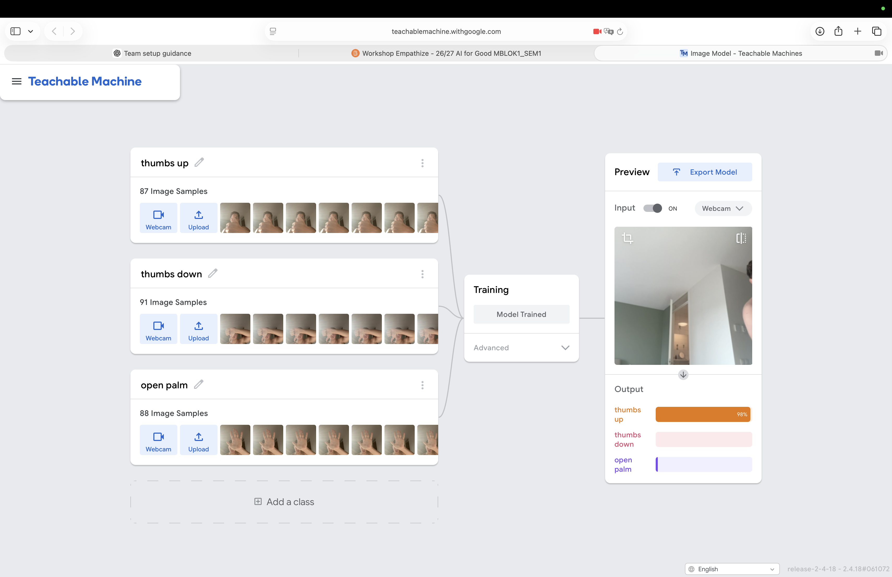

# Week 7 Teachable Machine evidence

- **Date tested:** 6 November 2026
- **My three image classes:** Thumbs Up, Thumbs Down and Open Palm
- **Number of training images:** Thumbs Up 87, Thumbs Down 91 and Open Palm 88
- **Screenshot filename:** `teachable_machine_classes_and_counts.png`
- **How I collected the images:** I used my webcam and moved my hand while recording. I changed the angle and distance and tried different positions, lighting and backgrounds. This gave the model more variation than taking the same picture many times.
- **How I tested the model:** After training, I showed new gestures that were not part of the recorded training samples. I changed my position and tested a harder angle and distance. I waited for the prediction bars to settle before writing down the result.
- **One test that worked:** A new Thumbs Up example was predicted as Thumbs Up at 74%. The other results were Thumbs Down 16% and Open Palm 10%. The saved screenshot also shows a live Thumbs Up prediction at 98%.
- **One test that failed:** I held an Open Palm sideways, farther from the camera and in a darker position. The model predicted Thumbs Down at 67% instead of Open Palm.
- **Likely reason for the failure:** The model probably had too few Open Palm examples at that sideways angle, distance and lighting. From that position, the outline of my hand may also have looked more like the Thumbs Down examples.
- **One possible harm:** If this model controlled an accessibility tool or smart-home command, a wrong prediction could trigger the wrong action for the user.
- **One safeguard:** The system should ask the user to confirm an action and ask them to repeat the gesture when the result is uncertain.

## Evidence screenshot

